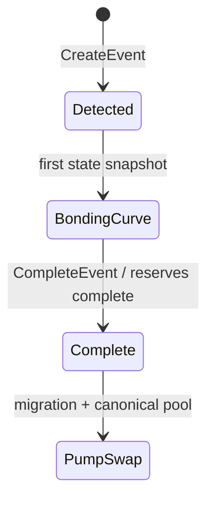

# PumpHound System Design

**Status:** Approved direction, implementation specification  
**Date:** 2026-09-07  
**Initial operator:** Single-user personal research  
**Primary environment:** Apple Silicon M4 Pro MacBook; detect RAM and size workloads accordingly  
**First production venue:** Pump.fun + PumpSwap on Solana mainnet  
**Trading mode:** Paper and replay only

## 1. Product thesis

PumpHound converts public Solana activity into predictive, auditable market intelligence. It is built around four linked capabilities:

1. **Market reconstruction:** derive current Pump.fun/PumpSwap state from official on-chain events and accounts.
2. **Persistent behavioural graph:** connect wallets, funding sources, launch cohorts, creators, tokens and outcomes over time.
3. **Calibrated prediction:** estimate explicit path/horizon probabilities rather than output an unexplained “good coin” score.
4. **Execution-realistic validation:** prove or disprove an edge with immutable live shadow predictions and paper fills after costs.

The system must remain useful if the trading strategy fails. The graph, creator/wallet history, risk evidence, replay and alerting are valuable terminal features independently.

## 2. User and core jobs

The v1 user is one technically capable operator researching and paper-trading new Solana microcaps.

The product must let the operator:

- notice a launch within seconds;
- distinguish organic demand from a small coordinated wallet ring;
- inspect creator and buyer history without switching between explorers;
- understand how much evidence is known versus inferred;
- see calibrated probabilities at a named horizon;
- paper-enter or let a deterministic policy paper-enter;
- observe exactly how the fill, costs, P&L and exit were calculated;
- replay a past launch using only information available at each historical instant;
- compare model/policy versions without overwriting prior results.

## 3. Product modes

| Mode | Data | Decisions | Orders |
|---|---|---|---|
| `LIVE_WATCH` | Current chain | Scores and alerts | None |
| `LIVE_PAPER_HEURISTIC` | Current chain | HEURISTIC_V1 | Simulated only |
| `LIVE_PAPER_SHADOW_ML` | Current chain | HEURISTIC_V1; ML comparison only | Simulated only |
| `LIVE_PAPER_ML` | Current chain | Four-champion compiled policy | Simulated only |
| `REPLAY` | Historical event log | Manual or policy | Simulated only |
| `RESEARCH` | Historical tables | Dataset/model jobs | None |

The mode is a first-class enum carried in APIs, stream messages, UI chrome, predictions, decisions and orders. There is no `LIVE_MONEY` enum in v1.

## 4. Canonical data-time model

Every derived datum carries:

- `slot`: Solana slot containing the underlying event.
- `block_time`: chain/RPC estimated block wall time when available.
- `observed_at`: PumpHound monotonic/wall-clock receipt time.
- `computed_at`: time a derived value was produced.
- `available_from_slot`: earliest slot at which the evidence was knowable.
- `commitment`: processed, confirmed or finalized.
- `knowledge_cutoff`: latest information time admitted to this live/replay view.
- `canonicality`: provisional, canonical, orphaned or unknown.

The live UI may show processed data quickly, but accounting and durable labels reconcile against confirmed/finalized data. Processed events that fork away are never deleted; they are marked orphaned and every affected snapshot/prediction is linked to the correction.

## 5. Non-negotiable invariants

1. **Raw evidence is immutable.** Parsed/canonical revisions reference it.
2. **Idempotent ingestion.** Replaying the same transaction creates no duplicate economic event.
3. **Exact units.** Atomic integer quantities plus explicit decimals and quote mint.
4. **Point-in-time correctness.** No future graph/profile/label state enters a past feature row.
5. **Prediction immutability.** A published prediction is appended, not updated.
6. **Policy separation.** Models estimate outcomes; policies decide; paper engine simulates execution.
7. **LLM isolation.** LLM output can explain or request tools but cannot modify scores, models, positions or orders.
8. **Evidence-preserving inference.** Wallet ownership/intent is probabilistic with provenance; addresses are not destructively merged.
9. **Degraded-state honesty.** Missing provider data yields `unknown` plus a quality flag, never a favourable default.
10. **No real execution.** No secret key, signing method or transaction sender ships in v1.

## 6. Supported on-chain lifecycle

Activity (`active`/`inactive`/`unknown`) is an independent, reversible flag, not a terminal lifecycle state. A quiet token can trade again without reversing migration.

The token identity persists across venues. A market/venue identity does not. All price and trade records name both token and venue.

## 7. Functional boundaries

### 7.1 Chain ingestion

Receives filtered transactions, account updates, slots and commitment updates. Stores raw envelopes, decodes Pump/PumpSwap events, assigns deterministic IDs and emits canonical events.

### 7.2 Market-state engine

Maintains per-market reserves, supply, price, curve progress, flow aggregates, holders and rolling windows. It emits immutable snapshots at event-driven and scheduled boundaries.

### 7.3 Graph engine

Appends factual edges, derives weighted behavioural edges, maintains versioned cluster memberships, computes reputations and publishes evidence-backed intent hypotheses.

### 7.4 Feature engine

Builds named feature sets from only point-in-time-valid values. The same feature definition runs in live, replay and training contexts.

### 7.5 Prediction engine

Loads an approved model bundle, validates feature schema hash, produces horizon-specific probabilities and stores the complete inference record before publishing.

### 7.6 Decision policy

Consumes probabilities, costs, liquidity, data quality, exposure and explicit thresholds. Canonical actions are `WATCH`, `ABSTAIN`, `PAPER_BUY` and `PAPER_SELL`. Holding, avoiding, reducing and exiting are reason/intent tags; reducing uses a smaller paper sell quantity, not another incompatible action enum.

### 7.7 Paper execution and accounting

Simulates quote, latency, adverse state movement, price impact, protocol/network fees, slippage checks, atomic success/failure and portfolio accounting.

### 7.8 API and desktop

REST provides authoritative snapshots/history. WebSocket supplies sequenced deltas. Tauri renders the terminal and contains no provider secrets or business logic.

### 7.9 Investigator

Uses retrieval tools over PumpHound evidence to produce a structured memo. It clearly separates facts, inferences, missing evidence and counterarguments.

## 8. Outcome vocabulary

Terms used in code and UI must have explicit definitions:

- **Graduated:** bonding curve completed and canonical PumpSwap migration was observed.
- **Inactive:** no qualifying trade for a configured horizon; not synonymous with rug.
- **Drawdown:** percentage fall from a defined reference price using executable paper quotes.
- **Rug-like outcome:** a versioned label rule combining severe executable-price drawdown with liquidity/flow conditions. This is a model label, not an accusation.
- **Coordinated cohort:** wallets with repeated statistically unusual temporal/behavioural overlap. It does not assert common ownership.
- **Creator-linked:** an evidence path connects creator and wallet above a named confidence threshold.
- **Organic score:** a versioned behavioural proxy derived from diversity/retention/independence features, not a probability or ground truth unless a separately defined target has been calibrated.

## 9. Product scoring

Never expose one mystery score. The token header shows:

| Signal | Meaning |
|---|---|
| Opportunity | Expected net path value under current policy; a separate rank is labelled as a rank |
| Rug-like risk | Probability of the versioned rug-like label by horizon |
| Graduation | Probability of migration by horizon |
| Momentum | Probability of hitting upside barrier before downside barrier |
| Organic demand | Versioned independence/retention score, not inferred ownership truth |
| Exit hazard | Probability of a named adverse exit event over the next horizon; compared with hold/exit outcomes separately |
| Data quality | Completeness/freshness/canonicality of evidence |

Every tile includes observation window, prediction horizon, model version and as-of time in its detail popover.

## 10. Success criteria

PumpHound v1 is successful when:

- it runs continuously on the Mac for 24 hours without duplicate events or unrecoverable gaps;
- live launches and trades appear in the GUI with measured receipt-to-render lag;
- token prices/reserves reconcile against on-chain state within defined tolerances;
- a $1,000 paper account can be run under manual and deterministic policy control;
- every fill decomposes protocol fee, network fee, priority/tip estimate, slippage and price impact;
- an operator can open any risk flag and see the evidence path;
- the same recorded session produces identical features, decisions and fills under deterministic replay;
- an XGBoost model beats declared baselines on strictly future data and reports calibration/robustness, or the GUI honestly shows that no approved model has qualified;
- the system stays useful as a live graph/forensics terminal even with the predictive model disabled.

## 11. Explicitly deferred work

A future project may create a separately audited live executor with hardware-backed key custody, transaction construction, simulation, Jito/Jupiter sending and capital limits. Nothing in this specification authorizes or hides that implementation.
