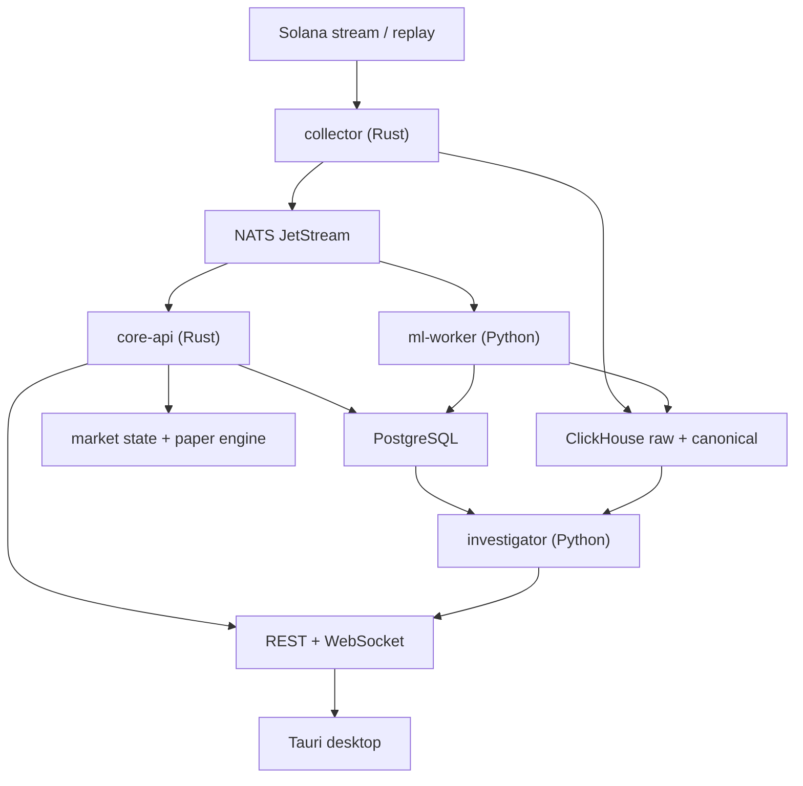

# Architecture and Repository Specification

## 1. Recommended architecture

Use a small number of real processes connected by stable contracts.



### Processes

| Process | Responsibility | Created when |
|---|---|---|
| `collector` | stream/replay input, raw envelope, Pump/PumpSwap decoding, idempotent persistence, canonical event publication | Milestone 1 |
| `core-api` | live market state, feature snapshots, heuristic/model calls, decision policy, paper engine, REST/WS | Milestone 2 |
| `desktop` | Tauri UI and local process orchestration | Milestone 2 |
| `ml-worker` | historical extraction, graph batches, labels, datasets, training, evaluation, model serving | Milestone 4/5 |
| `investigator` | evidence tools and LLM memo generation | Milestone 7 |

Do not split each responsibility into a separately deployed microservice. Rust modules can be extracted later without changing contracts.

## 2. Data ownership

| Store | Owns | Does not own |
|---|---|---|
| ClickHouse | raw/canonical chain events, market snapshots, feature rows, predictions, trade/fill time series | configuration, user state |
| PostgreSQL | token/market metadata, graph aggregates/memberships, model registry, strategy configs, paper ledger, watchlists, provenance | raw high-volume event tape |
| NATS JetStream | bounded durable event transport/replay between live processes | canonical long-term history |
| Parquet/artifact directory | offline datasets, backtest outputs, model bundles, reports | mutable application state |
| Desktop local store | layout/preferences and non-secret UI state | market truth, API keys |
| OS keychain | provider/API secrets | arbitrary app data |

No separate graph database in v1. Factual/aggregated edges live in PostgreSQL; heavy graph algorithms load time-bounded projections into python-igraph. This keeps one transactional source for graph versions and avoids a second query language/service.

## 3. Technology decisions

### Rust data plane

Use:

- Tokio for async runtime.
- tonic/prost for Yellowstone gRPC.
- serde/serde_json for boundary serialization.
- borsh/Anchor-compatible decoding driven by vendored official IDLs.
- sqlx for PostgreSQL.
- official ClickHouse Rust client.
- async-nats for JetStream.
- Axum for REST/WS.
- rust_decimal only at UI/report boundaries; atomic integers and rational arithmetic in core quote math.
- tracing + OpenTelemetry.

Why Rust: the stream/decode/hot-state/paper path needs predictable latency, memory safety and one deployable CPU binary per process.

### TypeScript desktop

Use Tauri 2 + React/Vite. Tauri starts or connects to the local backend, but all market/provider credentials stay outside the webview. Use generated TypeScript contracts from JSON Schema/OpenAPI where possible.

### Python research plane

Use Python 3.12 managed by uv. Polars and DuckDB query Parquet/ClickHouse exports; XGBoost/LightGBM train tabular models; scikit-learn handles baselines/calibration/metrics; SHAP explains; Optuna tunes bounded search spaces; MLflow records runs; igraph/leidenalg handles graphs. PyTorch Geometric is permitted only after tree baselines and graph aggregate features have plateaued.

## 4. Repository tree

Create files when their milestone uses them; this is the final intended shape, not a command to generate empty directories.

```text
pumphound/
├── README.md
├── justfile
├── compose.yaml
├── .env.example
├── Cargo.toml
├── rust-toolchain.toml
├── pnpm-workspace.yaml
├── package.json
├── pyproject.toml
├── uv.lock
├── apps/
│   └── desktop/
│       ├── src/
│       │   ├── app/
│       │   ├── components/
│       │   ├── features/{radar,token,graph,paper,replay,models,system,settings}/
│       │   ├── lib/{api,stream,format,units}/
│       │   └── styles/
│       └── src-tauri/
├── crates/
│   ├── domain/
│   ├── protocol-pump/
│   ├── protocol-pumpswap/
│   ├── chain-source/
│   ├── storage/
│   ├── market-state/
│   ├── feature-core/
│   ├── paper-core/
│   └── api-contract/
├── services/
│   ├── collector/
│   ├── core-api/
│   ├── ml-worker/
│   └── investigator/
├── ml/
│   ├── pumphound_ml/
│   │   ├── extraction/
│   │   ├── graph/
│   │   ├── features/
│   │   ├── labels/
│   │   ├── training/
│   │   ├── evaluation/
│   │   ├── registry/
│   │   └── serving/
│   └── configs/
├── db/
│   ├── postgres/
│   └── clickhouse/
├── schemas/
│   ├── json/
│   └── openapi/
├── vendor/
│   └── pump-idl/
│       ├── pump.json
│       ├── pump_amm.json
│       ├── pump_fees.json
│       └── SOURCE.lock
├── fixtures/
│   ├── chain/
│   └── replay/
├── artifacts/                 # gitignored except README
├── scripts/
└── docs/
    ├── decisions/
    └── runbooks/
```

## 5. Core internal interfaces

### `ChainSource`

```rust
#[async_trait]
pub trait ChainSource {
    async fn run(
        &mut self,
        cursor: Option<ChainCursor>,
        sink: mpsc::Sender<RawChainEnvelope>,
    ) -> Result<(), ChainSourceError>;
}
```

Implementations:

- `HeliusLaserstreamSource`
- `SolanaWebsocketSource`
- `ParquetReplaySource`

### `LaunchpadDecoder`

```rust
pub trait LaunchpadDecoder: Send + Sync {
    fn protocol(&self) -> Protocol;
    fn program_ids(&self) -> &[Pubkey];
    fn decode(&self, tx: &RawTransaction) -> Result<Vec<CanonicalEvent>, DecodeError>;
}
```

Implement:

- `PumpBondingCurveDecoder`
- `PumpSwapDecoder`

### `MarketReducer`

```rust
pub trait MarketReducer {
    fn apply(&mut self, event: &CanonicalEvent) -> Result<Vec<MarketDelta>, StateError>;
    fn snapshot(&self, as_of: ObservationPoint) -> MarketSnapshot;
}
```

The reducer is deterministic and contains no I/O. Live and replay use the same reducer.

### `FeatureComputer`

```rust
pub trait FeatureComputer {
    fn schema(&self) -> FeatureSchema;
    fn compute(&self, ctx: &PointInTimeContext) -> Result<FeatureVector, FeatureError>;
}
```

### `PredictionClient`

```rust
#[async_trait]
pub trait PredictionClient {
    async fn predict(&self, request: PredictionRequest) -> Result<PredictionBundle, ModelError>;
}
```

### `PaperVenue`

```rust
pub trait PaperVenue {
    fn quote(&self, order: &PaperOrderRequest, state: &MarketSnapshot) -> Result<PaperQuote, PaperError>;
    fn execute(&mut self, accepted: AcceptedPaperOrder, events: &[CanonicalEvent]) -> PaperOrderResult;
}
```

## 6. Runtime subjects

NATS subjects:

```text
chain.raw.<source>
chain.slot
market.event.pump
market.event.pumpswap
market.snapshot
graph.edge
graph.snapshot
feature.snapshot.<feature_set>
prediction.<target>.<horizon>
decision.paper
paper.order
paper.fill
system.health
```

Every message has `event_id`, `schema_version`, `sequence`, `observed_at` and a trace ID. Consumers use durable names and an idempotency table/checkpoint.

## 7. Deployment shapes

### Local Mac

Docker Compose runs PostgreSQL, ClickHouse and NATS. Rust/Python processes run natively for fast iteration. Tauri launches as a desktop process. Model training may use Apple CPU/GPU-capable libraries when convenient, but correctness does not depend on Metal.

### 24/7 production

One x86_64 Linux CPU VM in London, Amsterdam or Frankfurt runs the data plane and stores. Choose region by measured RTT to stream and future execution providers, not advertised bandwidth. Desktop connects over WireGuard/Tailscale or an SSH tunnel; do not expose databases publicly.

### GPU training

Vast.ai is a disposable training worker:

1. Upload a versioned Parquet dataset and training config.
2. Train/tune.
3. Produce signed/checksummed model bundle and report.
4. Download artifacts.
5. Destroy the instance.

Live inference stays CPU-based. Never place production DB credentials or wallet secrets on a marketplace GPU.

## 8. Avoided complexity

- No Kafka: NATS JetStream is enough for current durability and fan-out.
- No Kubernetes: Compose/systemd is enough for one operator.
- No feature-store server: versioned feature code + ClickHouse snapshots provide the necessary contract.
- No graph DB: PostgreSQL edges + in-memory igraph projections cover v1.
- No vector DB: investigator retrieval is structured SQL plus compact evidence JSON.
- No RL: supervised probability models and deterministic policies come first.

